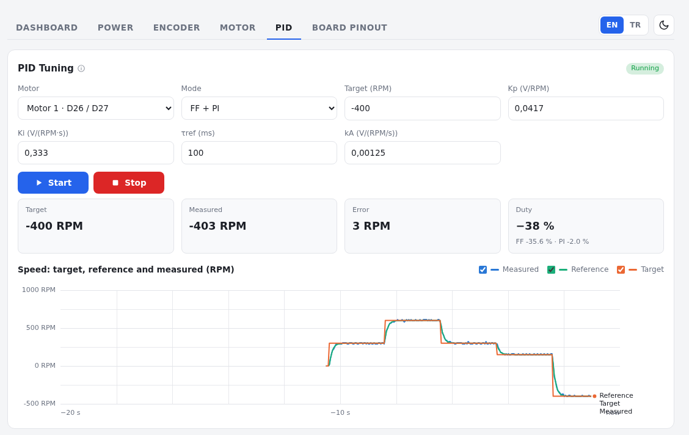
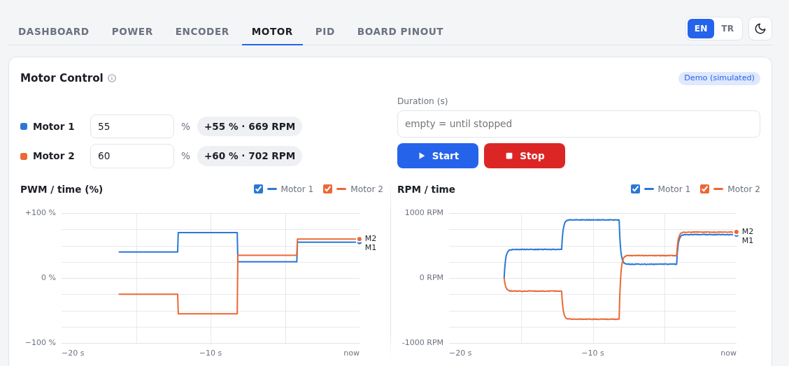
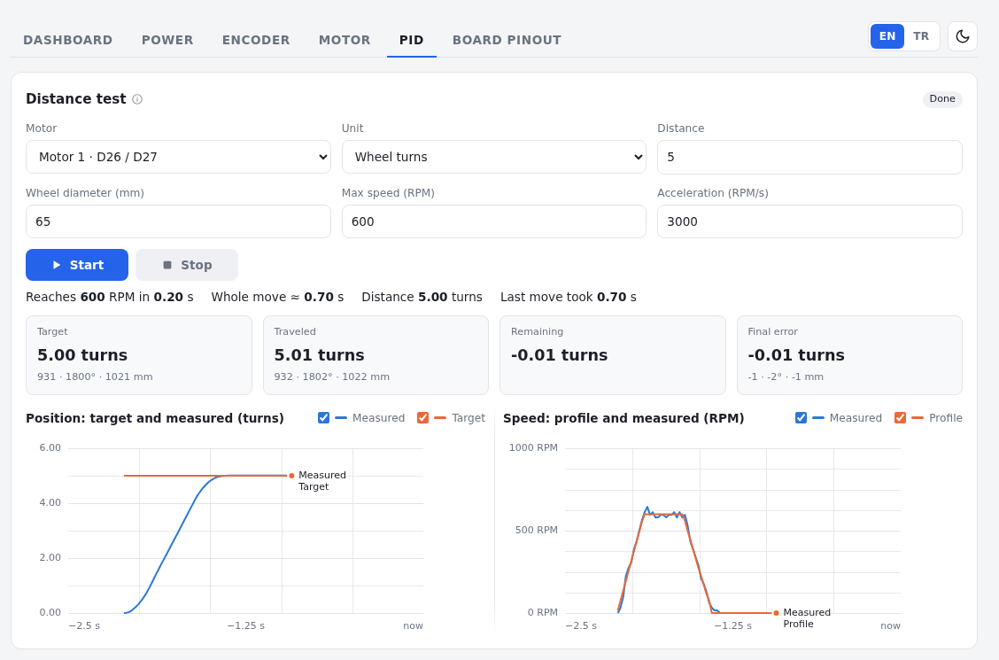

# ESP32 Motor Controller

> **Work in progress.** This branch builds on my [ESP32 Web Monitor](https://github.com/grboguz21/esp32-web-monitor/tree/main) draft.

Two 12 V encoder gear motors, driven and tuned from the browser over USB. No app to install: the dashboard is a single web page that talks to the ESP32 through Web Serial.

## Tabs

**Dashboard.** Is the board alive? Connection status, RAM, loop time and stack use, plus the serial log.

**Power.** Voltage, current and power for each motor from an INA219, with live charts and the lowest voltage / highest current since the last reset.

**Encoder.** Live count and speed for each motor. Find the counts per revolution by turning the shaft by hand, and flip the direction if it counts backwards.

**Motor.** Give each motor a duty and watch PWM and RPM side by side. Handy for checking wiring and direction.

**PID.** Speed control with feedforward + PI. Change the target or the gains while it runs and see target, reference and measured speed on one chart. The **Distance test** below it turns the wheel a set number of turns or meters and brakes on target.

**Board pinout.** The pins of the NodeMCU-32S or the DOIT DevKit V1 (pick one at the top) with what each one can do. Click a pin for details.

The Power and Motor shots use the built-in demo data. The PID and Distance shots are a recorded run of motor 1.

## Hardware

- ESP32S NodeMCU-32S (38 pins; a DOIT ESP32 DevKit V1 uses the same GPIOs)
- 2× GA25-370 12 V 1350 RPM gear motors with Hall encoders
- 1× L298N motor driver, motor 1 on channel A, motor 2 on channel B
- 1× INA219 current sensor on the driver's supply (optional; measures both motors together and the battery voltage)
- 3S battery and a robot power module (12 V pass-through and 5 V outputs)

## Wiring

| | Motor 1 (channel A) | Motor 2 (channel B) |
|---|---|---|
| L298N enable (ENA / ENB) | D4 | D16 |
| L298N + input (IN1 / IN3) | D2 | D17 |
| L298N − input (IN2 / IN4) | D15 | D0 |
| Encoder A (yellow) | D18 | D32 |
| Encoder B (green) | D19 | D33 |
| Encoder VCC (blue) / GND (black) | 3V3 / GND | 3V3 / GND |

Pull the ENA and ENB jumpers off the L298N. The enables are on D4 and D16 because those stay quiet while the ESP32 boots; D0, D2 and D15 are strapping pins and only carry the inputs. The INA219 (and the BNO055) use 3V3, GND, SDA → D21 and SCL → D22. Tie the 12 V ground to an ESP32 GND pin.

The dashboard draws all of this too: **Show motor wiring** under Motor Control, **Show wiring** on the Power tab.

## Trying it out

1. Open this folder in VS Code with the PlatformIO extension and check out the `motor-controller` branch.
2. Plug the ESP32 in and click **Upload** (the → arrow in the bottom bar).
3. Open `dashboard/index.html` in Chrome or Edge.
4. Click **Add port…**, pick your board, then **Connect**.

No hardware yet? Hit **Demo data** on the Power tab. Before uploading new code, click **Disconnect** so the port is free.

### Updating over Wi-Fi

1. Copy `secrets.ini.example` to `secrets.ini` and set a password (`secrets.ini` stays out of git). Upload once over USB so the board knows it.
2. Set `upload_port` in the `ota` env of `platformio.ini` to the board's address (shown in the dashboard's Wi-Fi card).
3. Let the board connect back to the PC: `sudo ufw allow from 172.20.10.0/28 to any port 40000 proto tcp` (your network's range).
4. Upload with `pio run -e ota -t upload`, or from the dashboard: run `python3 tools/build_server.py`, then **Build and upload** on the Dashboard tab shows the compile and upload progress.

The motors stop while an update runs and the board restarts with the new firmware.

Measurements and controller tuning for motor 1 are in [docs/motor-characterization.md](docs/motor-characterization.md).

## Next up

- characterize motor 2 the same way
- tests on the ground with the robot's weight
- drive both motors together (straight line, turns)

## License

MIT
