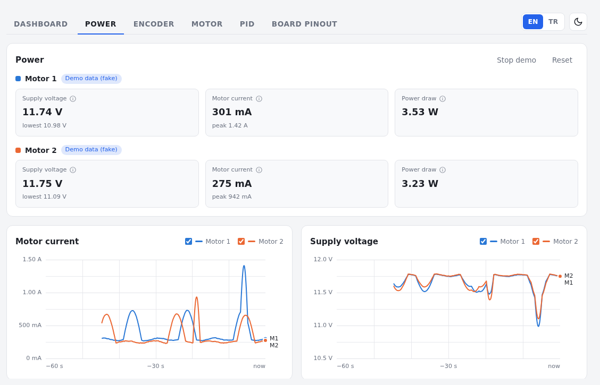
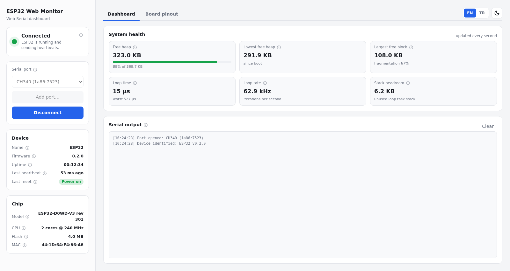
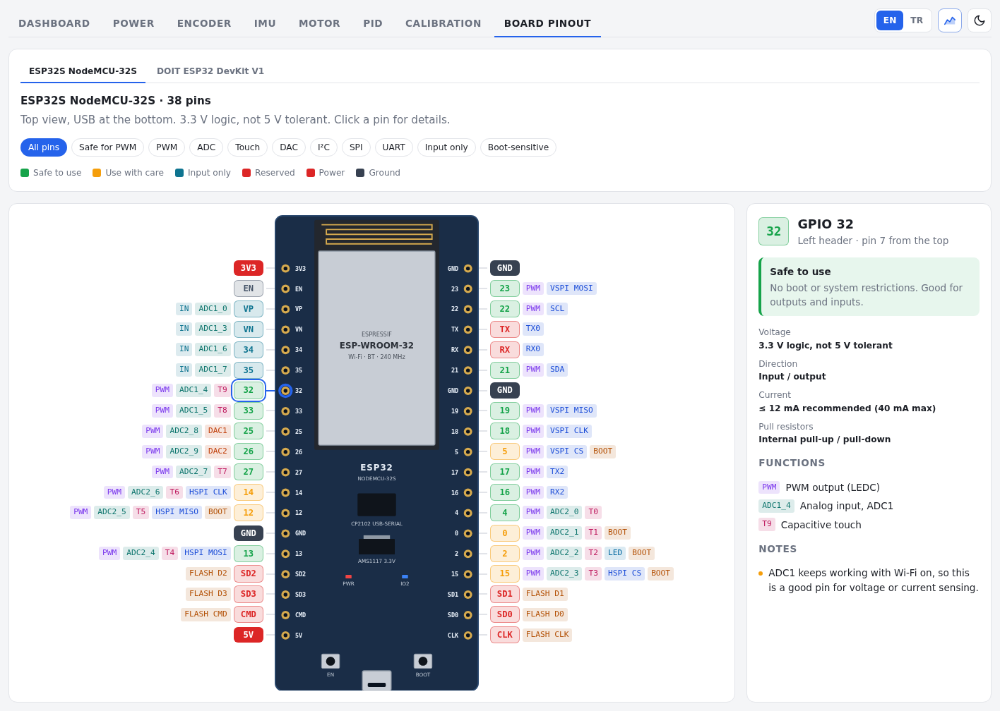

# ESP32 Motor Controller

> **Work in progress.** This branch builds on my [ESP32 Web Monitor](https://github.com/grboguz21/esp32-web-monitor/tree/main) draft.

I'm turning the monitor into a controller for two 12 V encoder gear motors, all from the browser over USB.
Motor control itself isn't in yet. Right now the dashboard shows how much power each motor pulls, which I wanted in place before the motors start moving.

What it does right now:

- everything the monitor does: connection status, board health, chip info, pinout
- reads one INA219 per motor and shows voltage, current and power
- live charts of both motors over the last 60 seconds, hover to see exact values
- remembers the lowest voltage and highest current, so a stall or a weak supply doesn't slip by
- a **Demo data** button, so you can see the charts without any sensors wired up
- the dashboard talking runs on core 0, which keeps core 1 free for motor control later

Measurements and controller tuning for motor 1 are in [docs/motor-characterization.md](docs/motor-characterization.md).

## Hardware

- DOIT ESP32 DevKit V1
- 2× 12 V 25 mm encoder gear motors
- 2× INA219 current sensor modules (bridge the A0 pads on the second one so it moves to address 0x41)
- 12 V 2 A power supply
- motor driver: still picking one

## Wiring

Both INA219 boards share the same four wires to the ESP32:

| INA219 | ESP32 |
|---|---|
| Vcc | 3V3 |
| Gnd | GND |
| Sda | D21 |
| Scl | D22 |

Each sensor sits in its own motor's supply line: `12 V (+) → Vin+ → Vin− → motor (+)`.
Tie the 12 V ground to an ESP32 GND pin, and never put 12 V on an ESP32 pin.

## Trying it out

1. Open this folder in VS Code with the PlatformIO extension and check out the `motor-controller` branch.
2. Plug the ESP32 in with a USB cable and click **Upload** (the → arrow in the bottom bar).
3. Close the PlatformIO serial monitor if it's open.
4. Open `dashboard/index.html` in Chrome. If it opens in another browser, right-click the file and choose **Open with → Google Chrome**.
5. Click **Add port…**, pick your board and click **Connect**.
6. Go to the **Power** tab. No sensors yet? Hit **Demo data**.

It only works in Chrome or Edge. Before uploading new code, click **Disconnect** so the port is free.

## Next up

- pick a motor driver and drive both motors with PWM
- read the encoders and show RPM
- PID speed control with sliders in the dashboard
- stop the motors when the dashboard goes quiet or the current gets too high

## License

MIT
